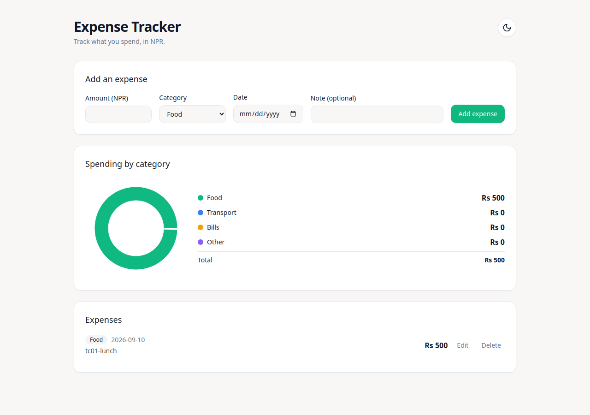
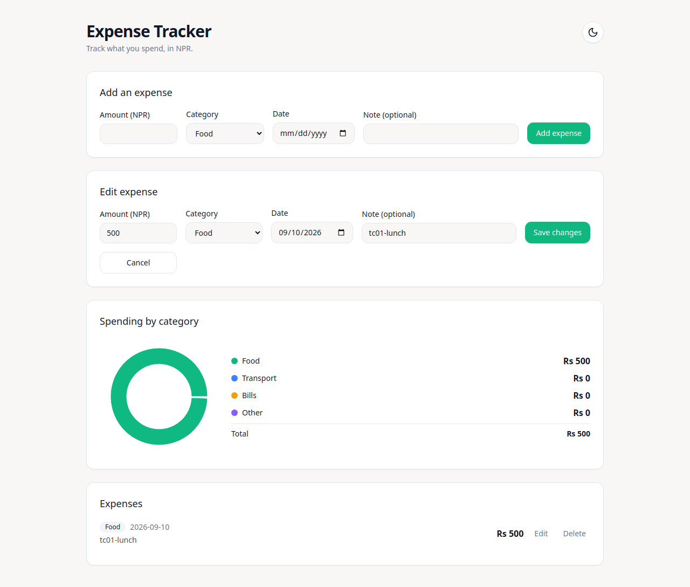
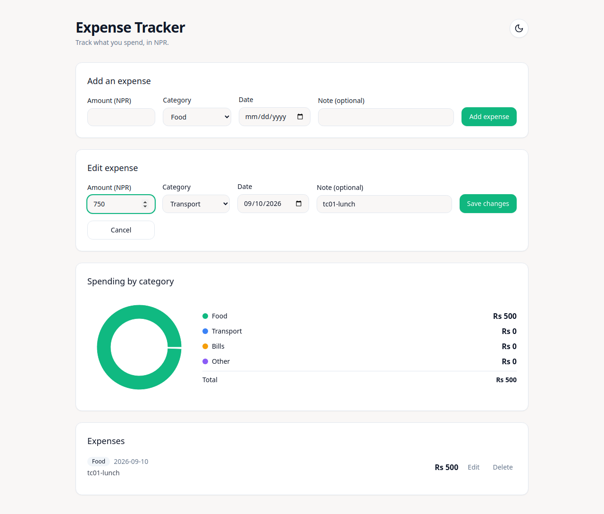
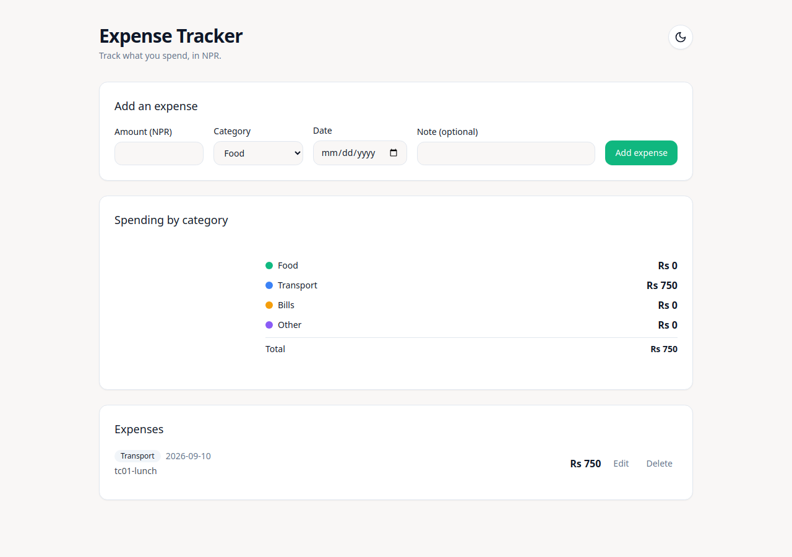
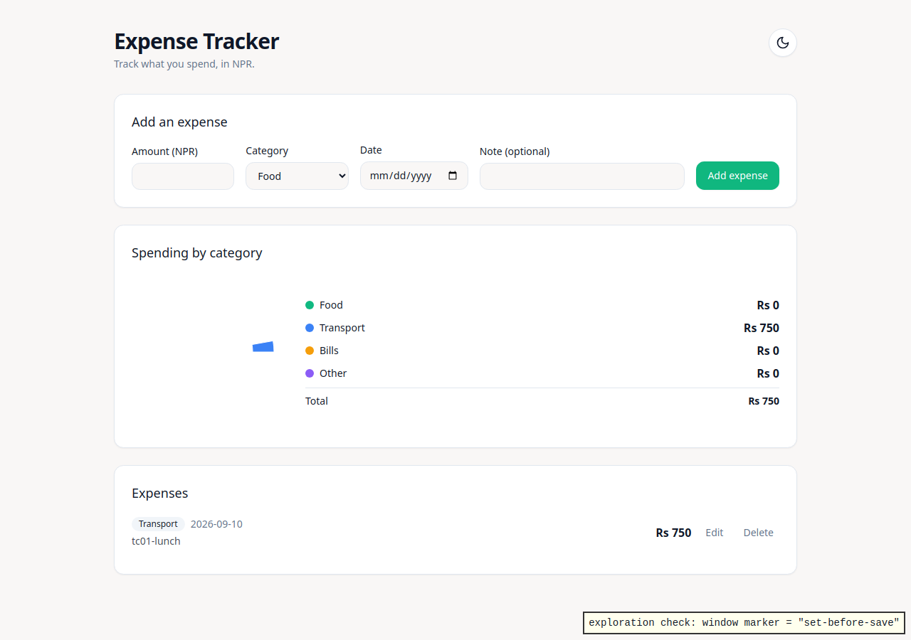

# Exploration — Task T-qa-edit-71bn5s — TC-01: Change amount and category, list updates without a reload
> The story of one test case walked on the landed build — QA stamps it before any e2e is written.
<!-- For the explorer (assist_explore has the full recipe): each `## Step` heading IS the frozen
case — never edit, add, drop or reorder one. Under each step fill Did / Saw / Verdict (pass | fail
| blocked) and show a screenshot named for the step: , 03a-,
03b- for several. Saw is what happened; if it differs from the heading, the verdict is fail.
Traces and video go in exploration/ (git-ignored, bound by sha256). Then: lane explore --record T-qa-edit-71bn5s -->

**Explored-At:** 81971f80c4b3981d2d420aeec41af5df85c57e28 (qa/flow-simple)
**Source:** 0002-enhancement-edit — all 1 task(s) landed
**Environment:** http://localhost:5173 (frontend, Vite dev) → http://localhost:8000 (backend, fresh throwaway SQLite), booted as the e2e webServer does · Chromium (Playwright 1.47.0) · 1280×900
**Explorer:** Claude Code (Opus 5.5), driving the Playwright 1.47.0 library from a script with one action per step (playwright-cli was not installed)

## Step 1 — Given the expense list is open and shows the "tc01-lunch" expense with amount 500 and category Food
**Did:** Created the precondition expense through the public API: `POST /api/expenses` with `{amount: 500, category: "Food", date: "2026-09-10", note: "tc01-lunch"}` (201, id 1). Opened http://localhost:5173 and waited for the network to go idle.
**Saw:** The Expenses list shows one row: a "Food" tag, 2026-09-10, note "tc01-lunch", amount "Rs 500", with Edit and Delete buttons.
**Verdict:** pass

## Step 2 — When the user opens edit on that expense, changes the amount to 750 and the category to Transport, and saves
**Did:** Set `window.__noReloadMarker = "set-before-save"`. Clicked the row's Edit button (accessible name "Edit Food expense of Rs 500"). In the "Edit expense" form, filled Amount (NPR) with 750 and selected Category "Transport", then clicked "Save changes".
**Saw:** An "Edit expense" panel opened under "Add an expense", pre-filled with 500, Food, 09/10/2026 and "tc01-lunch", with "Save changes" and "Cancel" buttons. After the amount and category were entered it showed 750 and Transport. After saving, the panel closed.
**Verdict:** pass

## Step 3 — Then the "tc01-lunch" row in the list shows amount 750 and category Transport, and the page was not reloaded
**Did:** Read the "tc01-lunch" row's text after the save and counted the rows containing "tc01-lunch". No reload was issued.
**Saw:** The row now shows a "Transport" tag, 2026-09-10, "tc01-lunch", "Rs 750". There is exactly one "tc01-lunch" row. Zero main-frame navigations happened between setting the marker and reading the row.
**Verdict:** pass

## Step 4 — Expected result: Right after saving, the row shows 750 and Transport. A marker set on the page before saving is still there afterwards, which proves no reload or navigation happened.
**Did:** Read `window.__noReloadMarker` after the save, and drew it on the page for the screenshot. Cross-checked the stored record with `GET /api/expenses`.
**Saw:** The marker still reads "set-before-save", so the page was not reloaded and did not navigate. The row shows Rs 750 and Transport right after saving. The API returns id 1 with amount 750, category Transport, and the same created_at as at creation.
**Verdict:** pass

## Outcome
**Outcome:** pass
**Classification:** <only on fail/blocked: product (the build is wrong) | case (the test case is wrong or unclear) | environment (the run could not happen)> — <one line why>

### Bug (only on fail — this becomes the fix ticket's evidence)
**Summary:** <the problem, not a solution>
**Steps to reproduce:** <the failing step numbers above>
**Expected / Actual:** <from the case / what was seen>

### Obstacles
- None. The app booted cleanly on a fresh database, and the only data was the precondition expense.

### Artifacts
- trace.zip — `npx playwright show-trace exploration/trace.zip` · video.webm (whole session; the library API has no video chapters, so each step has its own screenshot instead)

## Evidence manifest
<!-- written by lane explore --record — the stamp binds these hashes; do not edit -->
| File | sha256 |
|------|--------|
| 01-list-shows-tc01-lunch-500-food.png | 43946edb5d8c5ec19d0eed8ed86632f64fe72444169c2f089f5e8218bdeac090 |
| 02a-edit-form-open.png | 36fb0a79ab1ad1eade943346f5e5905dc7750050fedd9bd202c781de78f0e5cc |
| 02b-amount-750-category-transport-entered.png | 341ab130bbcf6e2acf1e4147ce5205280634479999363bae07f9b91e838fc0d9 |
| 02c-after-save.png | 7f5be1bcf1cfa4cd58aaa3e7375fd427f844dbcda246baaa53a8d9e6f9a97890 |
| 03-row-shows-750-transport.png | 7f5be1bcf1cfa4cd58aaa3e7375fd427f844dbcda246baaa53a8d9e6f9a97890 |
| 04-marker-survived-no-reload.png | 9beed6ed0e3544a31ef59227da300734a89256e6170c4b8f4ad586dd799a9b14 |
| trace.zip | c2af4e9198cb2f508324cb1cb6208f27636b5184367efa861f63c5fab1ce1234 |
| video.webm | 3a6ace59962b92c7d23bcf690efc2d4661f04c9727e36d6e834418b78be78399 |
